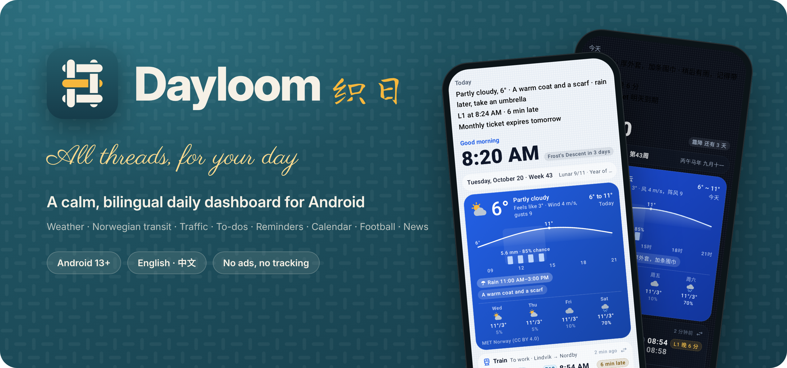
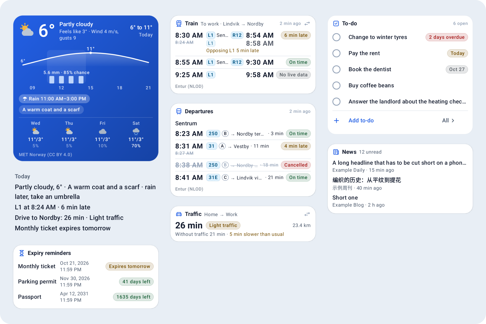

<p align="center">
  
</p>

<p align="center">
  <a href="https://github.com/lonemoonspace/Dayloom/releases/latest"></a>
  <a href="https://github.com/lonemoonspace/Dayloom/actions/workflows/ci.yml"></a>
  
  
  <a href="LICENSE"></a>
</p>

<p align="center">
  <b>English</b> · <a href="README.zh-CN.md">中文</a>
</p>

<p align="center">
  <a href="https://github.com/lonemoonspace/Dayloom/releases/latest"></a>
</p>

Dayloom weaves the things you check every morning into one quiet page: the weather and what to wear, your train or bus
and whether it is late, the drive to work, today's to-dos, what expires soon, the date in two calendars, your team's
next match and the news you follow. Every part is a module you can switch on or off, and the whole app speaks English
and Chinese.

## Your day, woven together

<table>
  <tr>
    <td width="33%" valign="top"><br><b>Weather</b><br><sub>MET Norway forecast, when the rain comes, what to wear, and each day's chance of rain.</sub></td>
    <td width="33%" valign="top"><br><b>Train and bus commutes</b><br><sub>Live Entur departures to work and home, changes, platforms, and warnings when a late opposing train holds yours.</sub></td>
    <td width="33%" valign="top"><br><b>Departure boards</b><br><sub>Your favourite stops with the next departures, delays and cancellations.</sub></td>
  </tr>
  <tr>
    <td valign="top"><br><b>Traffic</b><br><sub>The drive between two places right now, compared with an empty road.</sub></td>
    <td valign="top"><br><b>To-do</b><br><sub>Quick notes with optional due days; overdue items move the card to the top.</sub></td>
    <td valign="top"><br><b>Expiry reminders</b><br><sub>Passes, permits and documents, with a notification before each runs out.</sub></td>
  </tr>
  <tr>
    <td valign="top"><br><b>Calendar</b><br><sub>Clock, week number, lunar date, solar terms, and Chinese and Norwegian holidays.</sub></td>
    <td valign="top"><br><b>Football</b><br><sub>Fixtures, results, tables and top scorers for your team's competitions.</sub></td>
    <td valign="top"><br><b>News</b><br><sub>RSS and Atom feeds or your own Miniflux, with AI summaries from an endpoint you choose.</sub></td>
  </tr>
</table>

Above the cards, a few lines under **Today** sum up the day, and the same lines can arrive as a morning notification.
Cards can be reordered, themes change the colours, and a woven background runs behind it all.

## A closer look

<p align="center">
  
</p>

<p align="center"><sub>Drawn from sample data by <code>CardScreenshotTest</code>, so these pictures follow every layout change.
Full pages: <a href="docs/screenshots/home-en.png">English</a> · <a href="docs/screenshots/home-zh.png">中文</a> · <a href="docs/screenshots/home-zh-dark.png">dark</a>.</sub></p>

## Made to be trusted

<table>
  <tr>
    <td width="33%" valign="top"><b>Nothing collected</b><br><sub>No server of its own, no analytics, no ads, no accounts. Data comes straight from public services or ones you set up yourself; see <a href="PRIVACY.md">PRIVACY.md</a>.</sub></td>
    <td width="33%" valign="top"><b>Your keys stay yours</b><br><sub>No API key ships in the app. The keys you add are encrypted with the Android Keystore and only sent to the service they belong to.</sub></td>
    <td width="33%" valign="top"><b>Modules, not a monolith</b><br><sub>Each feature lives in <code>feature/&lt;id&gt;/</code> and is registered with one line; home, settings, refresh and notifications pick it up.</sub></td>
  </tr>
</table>

## Install

1. Download the latest APK from [Releases](https://github.com/lonemoonspace/Dayloom/releases/latest); each release lists its SHA-256.
2. Open it on a phone with Android 13 or newer and allow installing from your browser or file manager.
3. Pick your places, stops and modules in the short setup. Weather, transit, calendar, to-dos and reminders need no key.

Signed builds come only from this repository's GitHub Actions.

## Data sources

| Data | Source |
|---|---|
| Weather | [MET Norway](https://api.met.no/) (CC BY 4.0) |
| Public transport | [Entur](https://developer.entur.org/) (NLOD) |
| Place search | Entur, [OpenStreetMap Nominatim](https://nominatim.org/), or Google Places with your key |
| Traffic | Google Routes API with your key |
| Football | [football-data.org](https://www.football-data.org/) with your key |
| Lunar calendar | [lunar-java](https://github.com/6tail/lunar-java) (MIT) |

<details>
<summary><b>Build from source</b></summary>

JDK 17 and the bundled Gradle wrapper:

```bash
./gradlew verify          # unit tests + Android Lint + debug APK + release compile; must be green before every commit
./gradlew assembleDebug   # debug APK only
```

Debug builds include a small demo module that shows how a module plugs in; release builds do not.
The release process is described in `CLAUDE.md`. The README artwork is drawn by `scripts/readme/make_art.py`.

</details>

<details>
<summary><b>Architecture</b></summary>

```
app/      assembly: module registry, navigation, home and settings shells
feature/  one package per module; features never depend on each other
core/     infrastructure: module API, refresh, notifications, storage, secrets, network, time, i18n, UI
```

Dependencies point downwards only (`app → feature → core`); `ArchitectureTest` fails the build otherwise.
Details: [docs/design.en.md](docs/design.en.md).

</details>

## Status

Dayloom is in active development and still before 1.0: settings formats may change between versions. See the
[changelog](CHANGELOG.md) for what each release brings.

## License

[Apache License 2.0](LICENSE).
