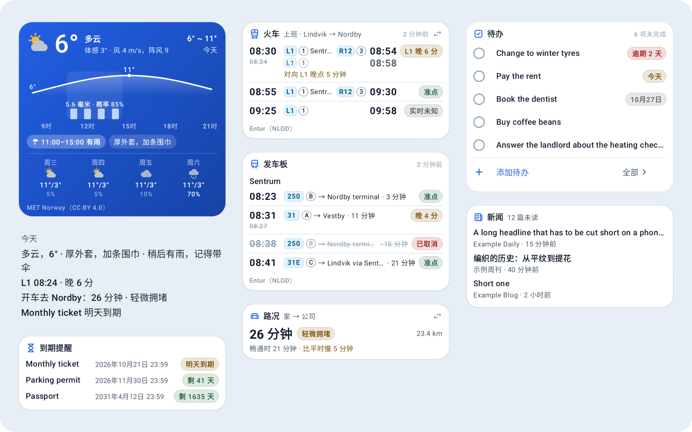

<p align="center">
  
</p>

<p align="center">
  <a href="https://github.com/lonemoonspace/Dayloom/releases/latest"></a>
  <a href="https://github.com/lonemoonspace/Dayloom/actions/workflows/ci.yml"></a>
  
  
  <a href="LICENSE"></a>
</p>

<p align="center">
  <a href="README.md">English</a> · <b>中文</b>
</p>

<p align="center">
  <a href="https://github.com/lonemoonspace/Dayloom/releases/latest"></a>
</p>

织日把每天早上要看的几样东西织进一个安静的页面：天气和该穿什么，火车、公交准不准点，开车上班要多久，今天的待办，
快到期的证件，公历和农历的日子，主队的下一场比赛，还有你关注的新闻。每一项都是可以单独开关的模块，整个 App 中英双语。

## 一天的千丝万缕

<table>
  <tr>
    <td width="33%" valign="top"><br><b>天气</b><br><sub>MET 挪威气象局预报，几点下雨、穿什么，以及每天的降水概率。</sub></td>
    <td width="33%" valign="top"><br><b>火车与公交通勤</b><br><sub>Entur 实时班次，上班下班两个方向，换乘、站台，对向车晚点拖住你这班时也会提醒。</sub></td>
    <td width="33%" valign="top"><br><b>发车板</b><br><sub>收藏的站点，接下来的班次、晚点和取消一目了然。</sub></td>
  </tr>
  <tr>
    <td valign="top"><br><b>路况</b><br><sub>两地之间此刻开车要多久，和畅通时比慢了多少。</sub></td>
    <td valign="top"><br><b>待办</b><br><sub>随手记下要做的事，可选截止日期；逾期时卡片自动置顶。</sub></td>
    <td valign="top"><br><b>到期提醒</b><br><sub>月票、停车证、护照，快到期前发通知。</sub></td>
  </tr>
  <tr>
    <td valign="top"><br><b>日历</b><br><sub>时钟、周数、农历、节气，以及中国和挪威的节日。</sub></td>
    <td valign="top"><br><b>足球</b><br><sub>主队所在赛事的赛程、比分、积分榜和射手榜。</sub></td>
    <td valign="top"><br><b>新闻</b><br><sub>RSS、Atom 订阅或自己的 Miniflux，可用你选的接口生成 AI 摘要。</sub></td>
  </tr>
</table>

卡片上方「今天」下面几行字概括这一天，同样的内容也可以每天早上以通知送达。卡片可以拖动排序，主题可以换颜色，背景是一层织纹。

## 细看

<p align="center">
  
</p>

<p align="center"><sub>由 <code>CardScreenshotTest</code> 用示例数据画出，界面一改，这些图片跟着更新。
整页截图：<a href="docs/screenshots/home-zh.png">中文</a> · <a href="docs/screenshots/home-zh-dark.png">深色</a> · <a href="docs/screenshots/home-en.png">English</a>。</sub></p>

## 值得信赖

<table>
  <tr>
    <td width="33%" valign="top"><b>什么都不收集</b><br><sub>没有自己的服务器，没有统计、广告和账号。数据直接来自公开服务或你自己配置的服务，见 <a href="PRIVACY.zh-CN.md">PRIVACY.zh-CN.md</a>。</sub></td>
    <td width="33%" valign="top"><b>Key 只属于你</b><br><sub>App 里不内置任何 API Key。你填的 Key 用 Android Keystore 加密，只发给它所属的服务。</sub></td>
    <td width="33%" valign="top"><b>模块化，而不是一整块</b><br><sub>每个功能都在 <code>feature/&lt;id&gt;/</code> 下，登记一行即可；首页、设置、刷新和通知自动接入。</sub></td>
  </tr>
</table>

## 安装

1. 从 [Releases](https://github.com/lonemoonspace/Dayloom/releases/latest) 下载最新的 APK；每个版本都附有 SHA-256。
2. 在 Android 13 及以上的手机上打开，允许浏览器或文件管理器安装应用。
3. 在简短的首次设置里选好地点、站点和模块。天气、公共交通、日历、待办和到期提醒都不需要 Key。

签名包只由本仓库的 GitHub Actions 构建。

## 数据来源

| 数据 | 来源 |
|---|---|
| 天气 | [MET 挪威气象局](https://api.met.no/)（CC BY 4.0） |
| 公共交通 | [Entur](https://developer.entur.org/)（NLOD） |
| 地点搜索 | Entur、[OpenStreetMap Nominatim](https://nominatim.org/)，或用你的 Key 调 Google Places |
| 路况 | 用你的 Key 调 Google Routes API |
| 足球 | 用你的 Key 调 [football-data.org](https://www.football-data.org/) |
| 农历 | [lunar-java](https://github.com/6tail/lunar-java)（MIT） |

<details>
<summary><b>从源码构建</b></summary>

使用 JDK 17 与仓库自带的 Gradle wrapper：

```bash
./gradlew verify          # 单元测试 + Android Lint + Debug 包 + Release 编译；每次提交前必须全绿
./gradlew assembleDebug   # 只打 Debug 包
```

Debug 版包含一个小的演示模块，展示模块如何接入；Release 版不包含。
发版流程见 `CLAUDE.md`。README 里的图由 `scripts/readme/make_art.py` 画出。

</details>

<details>
<summary><b>架构</b></summary>

```
app/      组装层：模块注册表、导航、首页与设置外壳
feature/  每个模块一个包；功能模块之间互不依赖
core/     基础设施：模块接口、刷新、通知、存储、凭据、网络、时间、国际化、界面组件
```

依赖只能向下（`app → feature → core`），否则 `ArchitectureTest` 会让构建失败。详见 [docs/design.md](docs/design.md)。

</details>

## 状态

织日在持续开发中，还没到 1.0：版本之间设置格式可能变化。每个版本的改动见[更新日志](CHANGELOG.md)。

## 许可证

[Apache License 2.0](LICENSE)。
